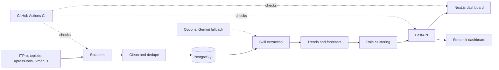

<div align="center">

# 🇱🇰 Job Market Intelligence Platform (Sri Lanka)

**Scrape Sri Lankan tech job ads, pull out the skills employers ask for, and forecast which ones are heading up.**

[](https://github.com/Dippy2003/job-market-intel/actions/workflows/ci.yml)


</div>

---

## ✨ What it does

Every run collects public job ads from **ITPro.lk**, **topjobs.lk**, **XpressJobs**, and the **Ikman.lk IT category**, cleans and de-duplicates them, finds the skills mentioned in each ad, and turns those into **weekly demand numbers**, an **8-week forecast** per skill, and **role clusters** such as Backend, Frontend, and Data/ML. The goal is to answer questions like *"Is demand for Docker growing in Sri Lanka?"* with data instead of guesses.

## 🧭 Architecture

Batch commands write PostgreSQL. FastAPI reads those tables. The Next.js app (and the Streamlit app) call the API. GitHub Actions checks the Python package and `web/`. It does not scrape or deploy.



The path from skill extraction through clustering is the order you run those commands. Each one reads and writes the database, and the API serves what they stored. Stage notes, tables, and routes are in [docs/architecture.md](docs/architecture.md). Hosting the API and the Next.js app is in [docs/deployment.md](docs/deployment.md).

## 🚀 Project status

| Feature | Status | Notes |
| --- | --- | --- |
| ITPro.lk scraper | ✅ Done | Category pages, 10 s crawl delay, raw HTML archived under `data/raw/` |
| topjobs.lk scraper | ✅ Done | Public "Recent 100 Jobs" page, 10 s+ delay, up to 100 ads per run |
| XpressJobs scraper | ✅ Done | IT category on xpress.jobs (xpressjobs.lk redirects there). Public HTML is a JavaScript shell, so this uses the site's public jobs API, which robots.txt allows. 10 s delay, 20 ads per run |
| Ikman.lk IT scraper | ✅ Done | `it-and-network-industry-jobs` only. Wildcard robots.txt rules are honored. First page only (25 ads), 10 s delay |
| Cleaning and de-duplication | ✅ Done | Normalized titles and locations; the same job on two sites is flagged via `duplicate_of` |
| Database schema + Alembic migrations | ✅ Done | `jobs`, `scrape_runs`, `skills`, `job_skills`, `skill_trends`, `forecasts`, `role_clusters`, `job_role_clusters` |
| Skill extraction | ✅ Done | 391-skill taxonomy, spaCy PhraseMatcher, optional Gemini fallback |
| Weekly trends + forecasts | ✅ Done | Prophet, or a linear fallback when there is too little history |
| Role clustering | ✅ Done | KMeans on binary skill TF-IDF; labels such as Backend, Frontend, Data/ML |
| REST API | ✅ Done | Read-only FastAPI: jobs, weekly skill demand, 8-week forecasts, role clusters |
| Dashboards | ✅ Done | Next.js app in `web/`, and Streamlit in `dashboard/`. Both call the API over HTTP |
| CI | ✅ Done | GitHub Actions: ruff, pytest, and the web lint, test, and build |
| Skill-extraction evaluation | 🚧 Partial | Scorer and sample export are in the repo. The hand-labelled 100-job file is not committed |
| Deployment | 📘 Guide only | [docs/deployment.md](docs/deployment.md). CI does not deploy |
| CV skill-gap checker | 🗓️ Planned | Not started |

## ⚙️ Quickstart

You need Python 3.11 and a PostgreSQL database (a free [Neon](https://neon.tech) project works). The web app needs Node.js 22.

**macOS / Linux (bash)**

```bash
git clone https://github.com/Dippy2003/job-market-intel.git
cd job-market-intel
python -m venv .venv && source .venv/bin/activate
pip install -r requirements.txt
cp .env.example .env
```

**Windows (PowerShell)**

```powershell
git clone https://github.com/Dippy2003/job-market-intel.git
cd job-market-intel
python -m venv .venv
.venv\Scripts\Activate.ps1
pip install -r requirements.txt
Copy-Item .env.example .env
```

Put `DATABASE_URL` in `.env`. The variable names are in the table below. Leave the values in that file, and keep `.env` uncommitted.

On a new database, Alembic creates the schema. Then check the connection:

```bash
alembic upgrade head
python -m db
```

`python -m db` should log `Connected: PostgreSQL ...`. It also applies any pending SQL files in `db/migrations/`. If those files already created `jobs` and `scrape_runs`, stamp the baseline before upgrading:

```bash
alembic stamp 0001
alembic upgrade head
```

## 🔐 Environment variables

Names only. Copy `.env.example` to `.env` for the Python tools, and `web/.env.example` to `web/.env.local` for the Next.js app. On a host, set the same names in that host's dashboard. See [docs/deployment.md](docs/deployment.md).

| Name | Required | Read by |
| --- | --- | --- |
| `DATABASE_URL` | yes | `config.py`, Alembic, the API, scrapers, and the batch commands |
| `LLM_API_KEY` | no | Gemini fallback during skill extraction. Blank means the fallback stays off |
| `LLM_MODEL` | no | Gemini fallback |
| `LLM_MIN_SKILLS` | no | Gemini fallback runs when the matcher finds fewer skills than this |
| `SCRAPER_USER_AGENT` | no | `scrapers/base.py`, from the environment. Include a contact email |
| `SCRAPER_MIN_DELAY` | no | `config.py`. The four site scrapers keep their own 10 second floor and do not read this setting |
| `SCRAPER_MAX_DELAY` | no | `config.py`. Same as `SCRAPER_MIN_DELAY`: the site scrapers do not read it |
| `LOG_LEVEL` | no | `config.setup_logging` |
| `CORS_ORIGINS` | no | API CORS allow-list. Comma-separated origins. If unset, every browser origin is allowed |
| `API_BASE_URL` | no | Streamlit client (`dashboard/api_client.py`) |
| `NEXT_PUBLIC_API_BASE_URL` | no | Next.js server (`web/lib/api.ts`), from `web/.env.local` |

`SCRAPER_USER_AGENT` is also declared on `config.py`. The scrapers read the environment variable in `scrapers/base.py`.

## ▶️ Run the scrapers and batch steps

From the repository root, with the virtualenv active and `DATABASE_URL` set:

```bash
python -m pipeline.run_daily
python -m pipeline.run_daily --source itpro
python -m pipeline.run_daily --source topjobs
python -m pipeline.run_daily --source xpressjobs
python -m pipeline.run_daily --source ikman
python -m pipeline.run_daily --source topjobs --max-jobs 5 --dry-run
python -m pipeline.run_daily --skip-scrape

python -m pipeline.extract_skills
python -m pipeline.extract_skills --limit 50 --dry-run

python -m pipeline.compute_trends
python -m pipeline.compute_trends --top 15 --dry-run

python -m pipeline.cluster_roles
python -m pipeline.cluster_roles --k 8 --dry-run
```

`run_daily` scrapes, cleans, and de-duplicates. Skill extraction, trends, and clustering are separate commands, in that order. `--dry-run` computes without writing. Re-running is safe: skills, trends, and forecasts are upserted, and clustering replaces the previous run.

The same commands work in PowerShell.

## ▶️ Run the API

From the repository root, so `config.py` can read `.env`:

```bash
uvicorn api.main:app
```

Interactive docs: <http://127.0.0.1:8000/docs>. The app allows GET and OPTIONS. Set `CORS_ORIGINS` when a browser on another origin should call the API.

A public host must listen on all interfaces and on the platform port. The command and the host dashboards are in [docs/deployment.md](docs/deployment.md).

## ▶️ Run the dashboards

Start the API first.

**Next.js** (`web/`), Node.js 22:

```bash
cd web
cp .env.example .env.local
npm install
npm run dev
```

Open <http://localhost:3000>. The page calls `NEXT_PUBLIC_API_BASE_URL`. Restart `npm run dev` after you change it. The Next.js server performs the API calls, so this page does not need browser CORS. More detail is in [web/README.md](web/README.md).

The page shows top skills for the latest week, a trend and forecast chart, role clusters, and recent postings for the selected skill. It renders on each request.

**Streamlit** (from the repository root, in a second terminal):

```bash
streamlit run dashboard/app.py
```

Open <http://127.0.0.1:8501>. The app calls the API at `API_BASE_URL`.

The four tabs are:

- **Jobs** filters by source (`itpro`, `topjobs`, `xpressjobs`, `ikman`, or all), a keyword (title, company, location, or description), and an exact skill name.
- **Skill trends** is a line chart of one skill over the newest N weeks.
- **Forecasts** ranks skills by the latest week of their stored 8-week forecast.
- **Roles** lists each cluster with the skills that define it.

Streamlit caches responses for 10 minutes (`st.cache_data(ttl=600)`). When the API is down, the page shows **API not reachable**.

## ✅ Tests

Python, from the repository root:

```bash
pytest -q
ruff check .
```

Web, from `web/`:

```bash
npm ci
npm test
npm run lint
npm run build
```

GitHub Actions runs the Python commands on Python 3.11 and the web commands on Node.js 22 for every push and pull request to `main`. The workflow does not use secrets. `npm run build` does not call the API.

Pytest stays offline: saved HTML and job fixtures, a mocked Prophet fit, FastAPI's TestClient with in-memory SQLite, and a mocked `requests` layer for the Streamlit client. `npm test` checks skill ranking and forecast selection and does not call the API.

## 🛠️ Tech stack

- **Language:** Python 3.11
- **Scraping:** `requests`, `BeautifulSoup4`, `lxml`
- **Database:** PostgreSQL on [Neon](https://neon.tech), via SQLAlchemy 2 and `psycopg` 3, with Alembic migrations
- **NLP:** spaCy (`PhraseMatcher` on a blank English pipeline, so no model download is needed), optional Gemini LLM fallback
- **Forecasting:** Prophet, with a least-squares linear fallback
- **Clustering:** scikit-learn KMeans on binary TF-IDF skill vectors
- **API:** FastAPI, served with uvicorn. Interactive docs at `/docs`
- **Dashboards:** Next.js in `web/`, and Streamlit in `dashboard/`. Both call the API over HTTP
- **Config:** `pydantic-settings` and `python-dotenv`
- **Quality:** `pytest` and `ruff`. CI also lints, tests, and builds `web/`

## 📁 Project structure

```text
job-market-intel/
├── scrapers/            # base.py (polite fetching, retries, robots.txt), itpro.py, topjobs.py, xpressjobs.py, ikman.py
├── pipeline/            # run_daily.py, clean.py, dedupe.py, extract_skills.py, compute_trends.py, cluster_roles.py
├── extraction/          # skills.py (PhraseMatcher), llm.py (optional Gemini), evaluate.py (offline score)
├── analytics/           # trends.py, forecast.py (Prophet + linear fallback), clusters.py
├── db/                  # SQLAlchemy models, Alembic migrations (db/alembic), legacy SQL
├── data/
│   └── skills_taxonomy.json   # 391 skills with categories and aliases
├── api/                 # read-only FastAPI routes (uvicorn api.main:app)
├── dashboard/           # Streamlit app (app.py) and API client (api_client.py)
├── web/                 # Next.js dashboard (App Router). See web/README.md
├── docs/                # architecture.md, deployment.md
├── tests/               # pytest suite with HTML and JSON fixtures
├── .github/workflows/   # ci.yml: ruff, pytest, and the web lint, test, and build
├── config.py            # settings loaded from environment / .env
├── alembic.ini
├── requirements.txt
└── .env.example
```

## 🔍 How the analysis works

**Skill extraction.** `data/skills_taxonomy.json` lists each skill with a category and aliases (for example `golang`, `k8s`). A case-insensitive PhraseMatcher finds them in the title and description. Short names are matched as whole tokens only, so `C` does not match inside `C++` and `Go` does not match `Google`. Overlaps keep the longer match (`SQL Server` over `SQL`). If an ad yields fewer than `LLM_MIN_SKILLS` skills and `LLM_API_KEY` is set, Gemini suggests catalog skills at a lower confidence. To add a skill, edit the JSON file.

**Trends.** Weeks start on Monday. Each skill gets a weekly job `count` and a `share` (count divided by all jobs that week). Duplicate postings are excluded.

**Forecasts.** With eight or more weeks of history a skill is forecast with **Prophet** (`prophet-weekly-1`). With two to seven weeks it uses a **linear fallback** (`linear-fallback-1`) with an 80% band. Counts never go below zero, and skills seen in only one week are skipped. This keeps the forecast honest while the dataset is still young.

**Role clusters.** `python -m pipeline.cluster_roles` groups non-duplicate jobs that already have skills. Each job is a binary TF-IDF vector of its skill names plus useful words from the title (seniority and generic words such as "engineer" are left out). KMeans uses `random_state=42`. The default `--k` is 6, and it drops when there are fewer distinct skill profiles. Fewer than 2 jobs with skills is reported and not clustered. Labels come from the skills and titles that dominate a cluster, for example Backend, Frontend, Data/ML, DevOps, QA, or Mobile. Two clusters that would share a name get the top skill appended. The run replaces the previous one: `role_clusters` stores the label, top skills, size, and `run_at`, and `job_role_clusters` stores which job is in which cluster (Alembic `0003`). If the database is already at `0002`, apply the new table with `alembic upgrade head`.

## 🤝 Ethical scraping

This is a student research project and it tries to be a good citizen:

- It reads each site's `robots.txt` and skips any URL it disallows.
- It waits **at least 10 seconds** between requests, and honors a longer `Crawl-delay` when a site publishes one for this agent.
- XpressJobs public pages are a JavaScript shell. The scraper calls the site's public read API (`/api/jobs/searchJobs` and `/api/jobs/publishedJob`), which `robots.txt` allows. It does not log in or call recruiter endpoints.
- Ikman `robots.txt` allows the IT category and ad pages, and disallows filtered, account, and edit URLs. Those wildcard rules are applied even though Python's `robotparser` does not understand `*`. Disallowed URLs are skipped and logged. Only the first category page is fetched.
- It only reads public listing and ad pages. It never logs in, submits forms, or applies to jobs.
- It identifies itself with a descriptive `User-Agent`. Set `SCRAPER_USER_AGENT` to include your own contact email.

If you run it, please keep these limits in place.

## 🗺️ Roadmap

- [x] ITPro.lk scraper
- [x] topjobs.lk scraper
- [x] Database schema and Alembic migrations
- [x] Cleaning and de-duplication
- [x] Skill extraction (spaCy + optional Gemini fallback)
- [x] Weekly trends and 8-week forecasts (Prophet + linear fallback)
- [x] Role clustering (KMeans on extracted skills)
- [x] FastAPI REST API
- [x] Streamlit dashboard and Next.js dashboard
- [x] CI with GitHub Actions
- [x] XpressJobs and Ikman.lk IT scrapers
- [x] Architecture diagram and deployment guide
- [ ] Hand-labelled 100-job sample scored and committed (the scorer is `python -m extraction.evaluate`)
- [ ] CV skill-gap checker

## 👤 Author

**Dipna Wijesinghe** — Data science Student  
GitHub: [@Dippy2003](https://github.com/Dippy2003)
