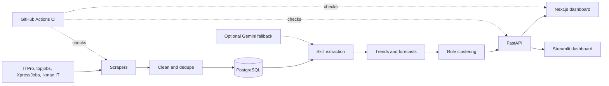

# Architecture

This is the system as it runs from `main`. Batch commands write PostgreSQL. The API reads those tables. Two dashboards call the API. GitHub Actions checks the code and does not scrape, migrate, or deploy.

The arrows from skill extraction through clustering are the order you run the batch steps. Each of those steps reads and writes PostgreSQL. FastAPI then reads the tables the batch steps stored. There is no queue between them.

## Scrapers

`scrapers/base.py` defines `BaseScraper`: polite GET requests, retries, `robots.txt`, a delay before each fetch, raw HTML under `data/raw/`, and inserts into `jobs` plus a row in `scrape_runs`. Subclasses set `source` and `base_url` and implement `listing_urls`, `parse_listing`, and `parse_job`.

| Source | Module | What a run collects |
| --- | --- | --- |
| `itpro` | `scrapers/itpro.py` | ITPro.lk category pages. Query-string URLs are skipped. Delay floor 10 seconds. |
| `topjobs` | `scrapers/topjobs.py` | The public Recent 100 Jobs list, then each ad, capped at 100. Delay floor 10 seconds. |
| `xpressjobs` | `scrapers/xpressjobs.py` | IT category on xpress.jobs. Public HTML is a JavaScript shell, so the scraper calls the site's public jobs API, which `robots.txt` allows. One page, 20 ads. Delay floor 10 seconds. |
| `ikman` | `scrapers/ikman.py` | Ikman.lk IT category only. Wildcard `robots.txt` rules are applied in the scraper. First page, 25 ads. Delay floor 10 seconds. |

`python -m pipeline.run_daily` runs the selected scrapers, then `pipeline.clean` and `pipeline.dedupe`. It does not extract skills or fit forecasts. `--source` chooses `itpro`, `topjobs`, `xpressjobs`, `ikman`, or `all`. `--dry-run` scrapes without writing. `--skip-scrape` only cleans and de-duplicates rows already in the database.

Cleaning fills `title_normalized` and `location_normalized` and leaves the original title and location columns as scraped. De-duplication sets `duplicate_of` to the kept row (the smallest id) when two rows share a URL, a content hash, or the same normalized title, company, and posted date.

## Database

PostgreSQL, through SQLAlchemy 2 and `psycopg`. `config.py` reads `DATABASE_URL`. Alembic revisions in `db/alembic/versions/` create the tables:

| Revision | Tables |
| --- | --- |
| `0001` | `jobs`, `scrape_runs` |
| `0002` | `skills`, `job_skills`, `skill_trends`, `forecasts` |
| `0003` | `role_clusters`, `job_role_clusters` |

`db/migrations/` holds the earlier SQL for `jobs` and `scrape_runs`. `python -m db` checks the connection and applies any of those SQL files that are not yet recorded. On a new database, run `alembic upgrade head` first so Alembic creates the full schema. Details are in the [deployment guide](deployment.md).

## Skill extraction

`python -m pipeline.extract_skills` loads `data/skills_taxonomy.json` (391 skills) into `skills`, then links jobs that have no `job_skills` rows yet.

`extraction/skills.py` matches the title and description with a spaCy `PhraseMatcher` on a blank English pipeline. Short names match as whole tokens. Overlaps keep the longer phrase. Matches are stored with method `spacy`.

When `LLM_API_KEY` is set and a posting has fewer matcher hits than `LLM_MIN_SKILLS`, `extraction/llm.py` asks Gemini for skills that are already in the taxonomy and stores those with method `llm`. With no key, that fallback stays off.

Jobs that match nothing are left pending so a later run can try again. Re-running upserts skills and links.

`extraction/evaluate.py` scores a hand-labelled JSONL file. It is an offline check, not a step in the daily pipeline. The labelled 100-job file is not in this repository. Tests use `tests/fixtures/`.

## Trends and forecasts

`python -m pipeline.compute_trends` rebuilds weekly demand and an 8-week forecast per skill.

`analytics/trends.py` dates a job by `posted_date`, or by `scraped_at` in Asia/Colombo when the posted date is missing. Weeks start on Monday. `count` is non-duplicate jobs that mention the skill. `share` divides that count by every non-duplicate job that week. Rows land in `skill_trends`.

`analytics/forecast.py` writes `forecasts`. Eight or more weeks of history use Prophet (`prophet-weekly-1`). Two to seven weeks use a linear fallback (`linear-fallback-1`). A skill seen in only one week is skipped. Counts stay at or above zero. Prophet is imported when a fit runs. The API imports the horizon constant from this module and does not fit a model on request.

## Role clustering

`python -m pipeline.cluster_roles` reads non-duplicate jobs that already have skills. `analytics/clusters.py` builds a binary TF-IDF vector from skill names and useful title words, then fits scikit-learn `KMeans` with `random_state=42`. The default `k` is 6, and it drops when there are fewer distinct skill profiles. Fewer than 2 jobs with skills is reported and not clustered.

Labels come from the skills and titles that dominate a cluster, such as Backend, Frontend, Data/ML, DevOps, QA, or Mobile. The run replaces `role_clusters` and `job_role_clusters`. Clustering uses skills, so it can run after extraction even when you skip forecasts. The usual order is extraction, then trends, then clustering.

## FastAPI

`api/main.py` builds a read-only app. `uvicorn api.main:app` serves it. CORS allows GET and OPTIONS for the origins in `CORS_ORIGINS`. A session from `api/deps.py` is opened per request, rolled back, and closed. Interactive docs are at `/docs`.

| Method and path | Role |
| --- | --- |
| `GET /health` | Process is up. Does not open the database. |
| `GET /jobs` | Postings. Filters: `source`, `q`, `skill`, `limit`, `offset`. |
| `GET /skills/trends` | Stored weekly demand. |
| `GET /skills/forecasts` | Newest eight stored forecast weeks per skill. |
| `GET /roles` | Clusters, top skills, and sizes. |
| `GET /roles/{id}` | One cluster and its jobs. |

`/jobs` still lists duplicates and returns `duplicate_of`. Trend and cluster batch jobs are the places that exclude duplicates.

## Dashboards

Both dashboards are HTTP clients of the API. They do not open PostgreSQL.

The Next.js app in `web/` (App Router) renders `web/app/page.tsx` on each request (`force-dynamic`). `web/lib/api.ts` calls `/health`, `/skills/trends`, `/skills/forecasts`, `/roles`, `/roles/{id}`, and `/jobs` from the Next.js server, using `NEXT_PUBLIC_API_BASE_URL`. The page shows top skills for the latest week, a trend and forecast chart, role clusters, and recent postings.

The Streamlit app in `dashboard/app.py` has tabs for Jobs, Skill trends, Forecasts, and Roles. `dashboard/api_client.py` reads `API_BASE_URL`. Responses are cached for 10 minutes.

## CI

`.github/workflows/ci.yml` runs on pushes and pull requests to `main`.

| Job | What it runs |
| --- | --- |
| `lint-and-test` | Python 3.11, `pip install -r requirements.txt`, `ruff check .`, `pytest -q` |
| `web` | Node.js 22, `npm ci`, `npm run lint`, `npm test`, `npm run build` in `web/` |

The workflow has no secrets. Pytest uses fixtures, an in-memory SQLite database for the API, and mocks for Prophet and HTTP. The web test checks chart helpers offline. `npm run build` does not call the API. CI does not deploy.

## Configuration

Secrets and host-specific URLs stay in the environment or a local `.env` file, loaded by `config.py` (`pydantic-settings`). The Next.js app reads `web/.env.local`. Names are listed in the README. Values are not committed. `alembic.ini` does not hold a real database URL; `db/alembic/env.py` passes `DATABASE_URL` through.
